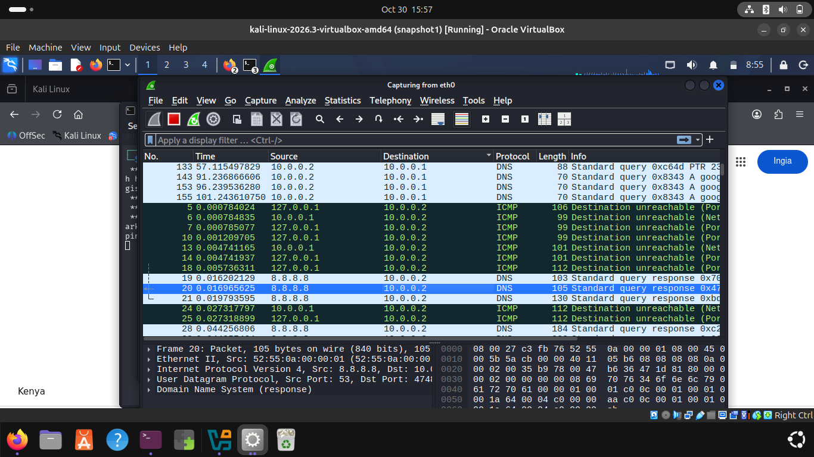
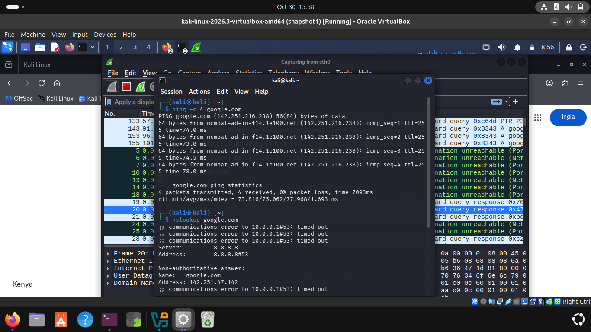

# Wireshark Network Traffic Analysis

## Project Overview
This project demonstrates practical network traffic capture and basic network analysis using Wireshark on Kali Linux.

The objective is to understand how network communication works by capturing and observing packets generated through basic network activities.

## Tools Used
- Kali Linux
- Wireshark
- Terminal
- VirtualBox

## Practical Activities Completed
1. Launched Wireshark on Kali Linux.
2. Selected a network interface for packet capture.
3. Captured live network traffic.
4. Generated network traffic using ping.
5. Performed DNS lookups using nslookup.
6. Observed captured packets and their protocols.

## Screenshots

### 1. Network Traffic Capture

### 2. Traffic Generation

## Learning Outcomes
- Understanding basic packet capture.
- Identifying source and destination IP addresses.
- Understanding the purpose of DNS and ICMP.
- Becoming familiar with the Wireshark interface.
- Developing practical network troubleshooting and analysis skills.

## Environment
- Operating System: Kali Linux
- Virtualization: Oracle VirtualBox
- Packet Analysis Tool: Wireshark

## Project Status
Initial packet capture and traffic generation completed. Further protocol analysis will be added as the project progresses.

## Author
Ambrose Opondo

